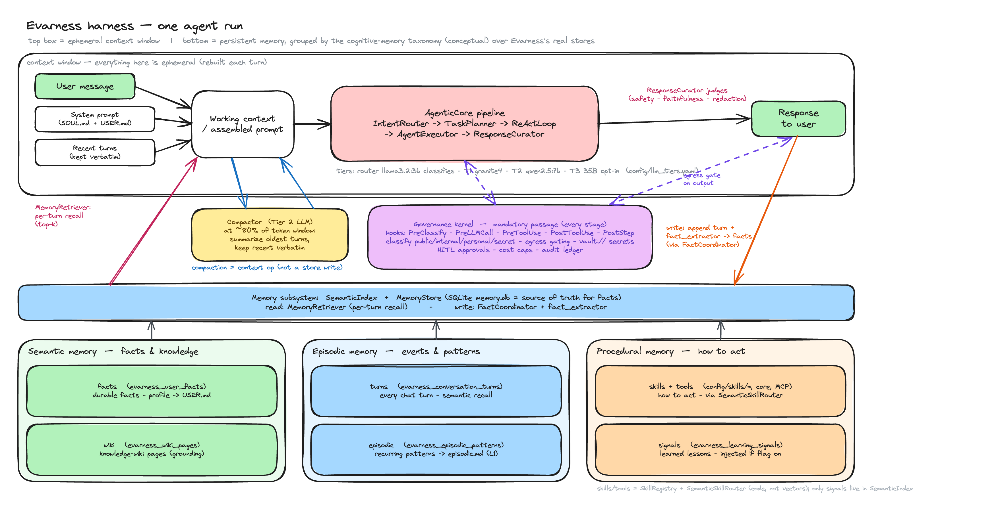
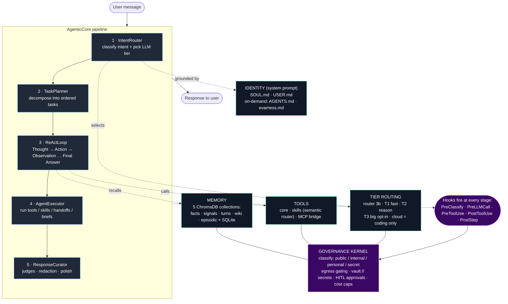

# Evarness Harness — High-Level Architecture Diagram

> **Conceptual, not a code map.** The diagrams on this page are a mental model drawn
> for orientation. Their boxes are named for ideas, not for modules: several do not match
> a class or a file one to one, and the real turn has stages the sketch leaves out. When a
> diagram disagrees with the code, the code wins. The table [Concept to code](#concept-to-code)
> maps each box to where it lives.

A basic, one-glance view of how the Evarness harness operates, intentionally simplified and
hand-drawn. For the authoritative operational detail (stage-by-stage behavior, tiers,
hooks, memory model), see [`evarness.md`](./evarness.md); for design rationale see
`project-evarness-prd/03-architecture-overview.md`.

## One agent run (hand-drawn)

*The rendered image predates the rename and still says IRIS; the editable source below is current. Re-export it from Excalidraw to refresh the image.*

Editable source: [`harness-architecture-diagram.excalidraw`](./harness-architecture-diagram.excalidraw)
(open at [excalidraw.com](https://excalidraw.com) or with the VS Code Excalidraw extension).

- **Top box = the ephemeral context window**, rebuilt each turn: inputs (user
  message + `SOUL.md`/`USER.md` system prompt + recent turns) → assembled prompt →
  the **AgenticCore pipeline** (IntentRouter → TaskPlanner → ReActLoop →
  AgentExecutor → ResponseCurator) → **Response to user**. Compaction
  (`compactor.py`, ~80% of the token window) is a context-window op, not a store write.
- **Bottom = persistent memory**, grouped under the standard cognitive-memory
  taxonomy as a *conceptual lens* over Evarness's real stores (the code does not name
  them this way): **semantic** = `facts` + `wiki`; **episodic** = `turns` +
  `episodic`; **procedural** = `skills`/`tools` + `signals`. One **Memory subsystem**
  block (`SemanticIndex` + `MemoryStore`, SQLite `memory.db` = truth) mediates
  reads (`MemoryRetriever`) and writes (`FactCoordinator` + `fact_extractor`).
  Note: `skills`/`tools` are code (`SkillRegistry` + `SemanticSkillRouter`), not
  vectors — only `signals` actually live in `SemanticIndex`.
- **Governance kernel = a cross-cutting layer, not a step.** Hooks fire at every
  stage — `PreClassify` · `PreLLMCall` · `PreToolUse` · `PostToolUse` · `PostStep`
  (mandatory passage; bypass is a CI failure) — enforcing classification
  (`public`/`internal`/`personal`/`secret`), egress gating, `vault://` secret
  resolution, HITL approvals, cost caps, and the audit ledger. The final
  `ResponseCurator` judges (safety / faithfulness / redaction) run in-process
  before the reply. See [`unified-governance-layer.md`](./unified-governance-layer.md).

## Simplified flow (text-based)

Conceptual, like the sketch above: see [Concept to code](#concept-to-code).

## Mental model

A message is **classified and routed** (IntentRouter → tier), **planned**
(TaskPlanner), then worked through a **ReAct loop** that calls **tools**
(core / skill / MCP), backed by a **5-collection memory** and grounded by the
**identity files**. Everything is wrapped by a **governance kernel** that tags data
`public/internal/personal/secret`, blocks personal data from leaving to cloud,
resolves secrets via `vault://` (never in prompts), and enforces HITL approval for
side-effecting actions. A final **ResponseCurator** runs safety/faithfulness judges
before the answer reaches the user.

## Concept to code

Where each box in the diagrams lives, and where the sketch simplifies. Paths are under
`src/evarness/` unless noted. Verified against the code on 2026-10-11.

| Diagram box | In the code | Where the sketch differs |
|---|---|---|
| The whole pipeline ("AgenticCore pipeline") | `runtime/turn/pipeline.py`: `STAGES`, run in order by `run_turn` | The real turn has ten stages: `screen`, `intercept`, `classify`, `route`, `plan`, `execute`, `curate`, `guard`, `notice`, `record` (`runtime/turn/stages/`). The sketch draws five of them as one chain. |
| 1 · IntentRouter | `agent/intent_router.py`, run by the `classify` and `route` stages | `classify` also applies deterministic refinements (`resolve`) before routing. |
| 2 · TaskPlanner | `agent/task_planner.py`, the `plan` stage | It splits a request only when the tasks need different agents. |
| 3 · ReActLoop | `agent/agentic_core.py` (`ReactStep`, `ReactTrace`, the loop primitives) | There is no class named `ReActLoop`; the loop is part of the agentic core. |
| 4 · AgentExecutor | `agent/agent_executor.py`, the `execute` stage | Every tool call runs through `GovernedToolRunner` (`agent/tool_runner.py`). |
| 5 · ResponseCurator | `agent/response_curator.py`, the `curate` stage | A deterministic answer skips it and goes through the `guard` stage, which runs the same model-free checks. |
| (not drawn) deterministic handlers | `intercept` stage; plugins register them through the SDK | A handler that claims the turn answers with no model, so `classify` to `curate` do not run. |
| (not drawn) input screen and record | `screen` and `record` stages | Every turn is screened first and recorded last, however it was answered. |
| TIER ROUTING | `llm/tier_router.py`, `config/llm_tiers.yaml`; per host, `config/doctor.yaml` model sets applied through `llm/tier_edits.py` | The config names more tiers than the sketch: `router`, `tier1` to `tier3`, plus `code_exec`, `gemma`, `vision`, `email_judge` and `fallback`. A model set (`standard`, `lite`) overrides some of them for the machine `evarness doctor` finds; the overrides live in the settings store, not in the file. |
| TOOLS: core, skills, MCP bridge | `tools/skills/registry.py`, `tools/skills/semantic_router.py`, `tools/mcp_bridge.py` | Plugins add tools through `PluginAPI`. |
| MEMORY: five collections and SQLite | `memory/semantic_index.py` (the five ChromaDB collections), `memory/store.py` (SQLite), `memory/retriever.py`, `memory/coordinator.py` | The semantic/episodic/procedural grouping is a lens; the code does not use those names. The `memris` package (`src/memris/`) is the claim graph, separate from these stores. |
| IDENTITY (`SOUL.md`, `USER.md`) | `memory/identity/loader.py` | |
| GOVERNANCE KERNEL | `kernel/governance/` (`kernel.py`, `egress_policy.py`, `vault/`, `approvals/`, `audit/`) | It is a layer every call passes, not a step in the chain. |
| Hooks | `HookPoint` in `kernel/governance/hooks/types.py` | The sketch lists five. There are nine: `pre_turn`, `pre_classify`, `pre_llm_call`, `pre_tool_use`, `post_tool_use`, `post_step`, `pre_response`, `pre_egress`, `post_egress`. |
| Services | `server/` | The four services (API 8003, Governor 8080, evaluator 8090, channel gateway 8006) are not drawn. |

For the layered package structure the diagrams leave out, see `AGENTS.md` at the
repository root and `[tool.importlinter]` in `pyproject.toml`.
